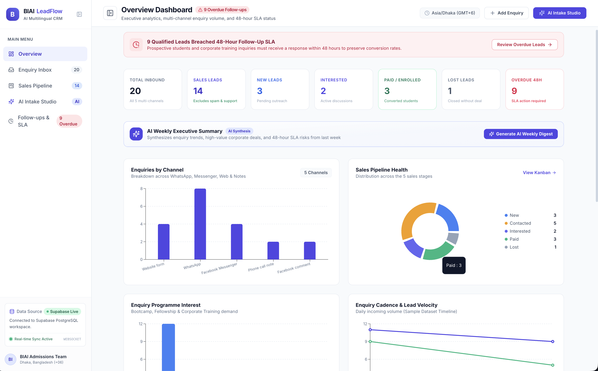
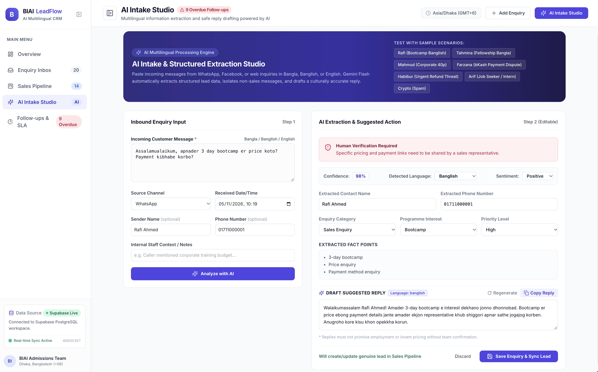
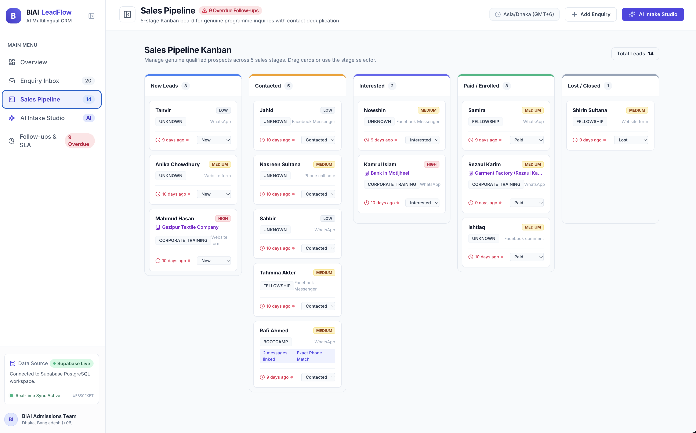
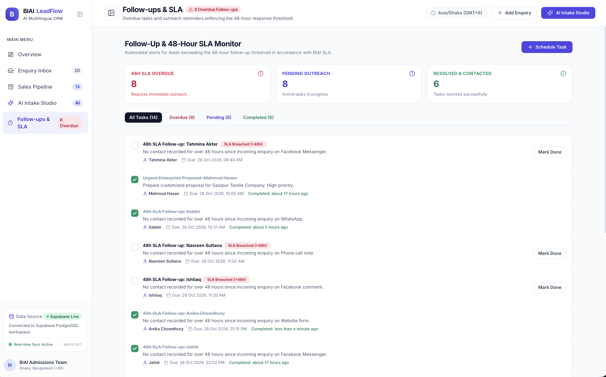
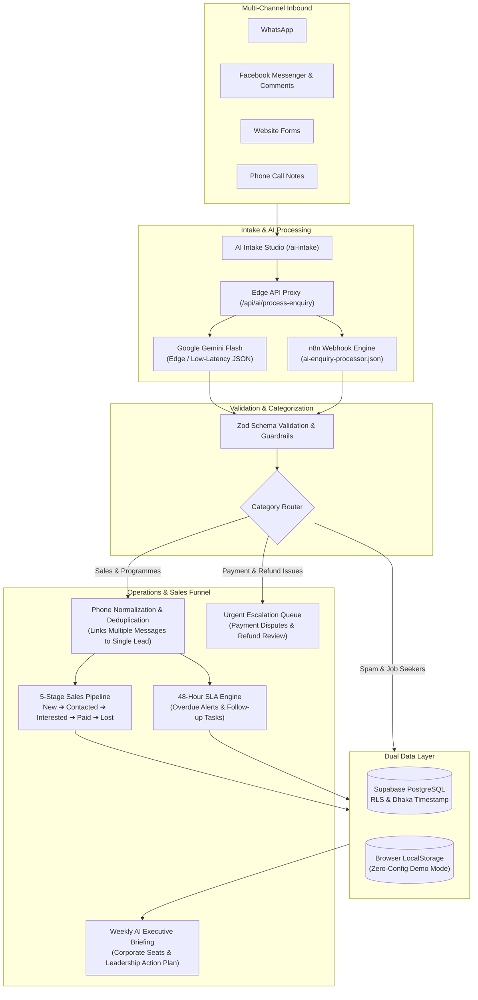

# BIAI LeadFlow — AI-Powered Multilingual CRM

<p align="left">
  
  
  
  
  
  
  
  
  
</p>

An intelligent, production-ready CRM built for the **Bangladesh Institute of Artificial Intelligence (BIAI)** to manage multi-channel inbound enquiries, extract structured intelligence from unstructured text in **Bangla (বাংলা)**, **Banglish**, and **English**, enforce a 5-stage sales pipeline with automated contact deduplication, and eliminate follow-up slippage with a 48-hour SLA engine.

---

## Screenshots


|                                                                Overview Dashboard & Weekly AI Summary                                                                |                                                               Multilingual AI Intake Studio                                                               |
| :-------------------------------------------------------------------------------------------------------------------------------------------------------------------: | :-------------------------------------------------------------------------------------------------------------------------------------------------------: |
|  <br> *Real-time metrics, multi-channel distribution, SLA alerts, and Gemini-generated weekly executive summary* |  <br> *Intelligent extraction from Banglish/Bangla with safety guardrails and one-click draft replies* |


|                                                          5-Stage Sales Pipeline (Kanban)                                                          |                                                           Follow-ups & 48-Hour SLA Monitor                                                           |
| :------------------------------------------------------------------------------------------------------------------------------------------------: | :---------------------------------------------------------------------------------------------------------------------------------------------------: |
|  <br> *Drag-and-drop Kanban board (`New` → `Paid`) with automatic phone-based lead deduplication* |  <br> *Automated SLA tracking flagging leads unattended beyond 48 hours with direct task resolution* |

---

## The Problem & How LeadFlow Solves It

BIAI receives customer enquiries across five fragmented channels: **WhatsApp**, **Facebook Messenger**, **Facebook comments**, **Website forms**, and **Phone call notes**.

Without a unified intake system:

- Enquiries get lost across personal chat accounts and spreadsheets.
- Team members cannot track who is waiting for follow-ups, causing response delays.
- Spam, job applications, and student support inquiries pollute the sales funnel.
- Reps spend significant manual effort drafting replies in different languages and scripts.

### Core Solutions

1. **Intelligent Multilingual Intake Studio**: Reads unstructured inbound text in Bengali script, Banglish, or English. Uses Google Gemini Flash to extract sender names, phone numbers, programme interests, priority, and sentiment with strict null-safety (never inventing missing names or phone numbers).
2. **Culturally Attuned Suggested Replies**: Generates contextually accurate replies in the sender's language with single-click copying, while enforcing strict safety guardrails (no hallucinated prices, fake refund terms, or job guarantees).
3. **5-Stage Sales Pipeline with Deduplication**: A Kanban board (`New`, `Contacted`, `Interested`, `Paid`, `Lost`) with drag-and-drop state transitions. Genuine sales leads are deduplicated by normalized phone number (linking multiple messages, such as successive WhatsApp inquiries, to a single lead record without overwriting history).
4. **Non-Sales Isolation & High-Priority Escalations**: Automatically isolates spam and job applicants from the sales pipeline, while immediately escalating payment verification issues (e.g. bKash/Nagad transactions) and angry refund threats for management intervention.
5. **48-Hour SLA Monitoring**: Automatically flags any qualified lead exceeding 48 hours without contact, preventing lead abandonment.
6. **AI Weekly Executive Intelligence Brief**: Synthesizes real weekly volume, qualification rates, corporate training deal potential, urgent payment/refund escalations, and SLA risks into an executive summary for leadership.

---

## System Architecture



---

## Core Capabilities

### 1. Multilingual Intake Studio (`/ai-intake`)

- **Direct message paste**: Paste messages from any channel with optional contact details.
- **Quick-load scenarios**: One-click presets covering typical customer personas (Banglish bootcamp inquiries, Bengali script fellowship questions, corporate training leads, bKash payment confirmations, refund threats, and spam).
- **Safety boundaries**: If an inquiry asks about fees, job placement, or cancellation terms, the model politely acknowledges the question and explains that the admissions office will provide official details.
- **Editable output**: Every field extracted by AI can be manually reviewed and edited before committing to the database.

### 2. 5-Stage Sales Pipeline (`/pipeline`)

- **Kanban stages**: `New` → `Contacted` → `Interested` → `Paid` → `Lost`.
- **Drag-and-drop**: Smooth card transitions powered by `@hello-pangea/dnd`.
- **Contact deduplication**: Automatically matches incoming enquiries by normalized phone number (`01XXXXXXXXX`), ensuring repeat messages from the same prospective student are aggregated into a single lead history.
- **Lead detail modal**: Inspect linked messages side-by-side, view chronological audit logs, update strategy notes, and assign follow-up tasks.

### 3. Follow-ups & 48-Hour SLA Monitor (`/followups`)

- **Automated threshold tracking**: Tracks hours elapsed since the latest interaction. Leads unattended for over 48 hours are automatically marked with red SLA warning tags.
- **Task completion**: Single-click task resolution with persistent activity audit trails.
- **Manual scheduling**: Schedule custom callbacks and task reminders linked directly to leads.

### 4. Executive Overview & AI Weekly Summary (`/`)

- **Real-time KPI metrics**: Total inbound volume, qualified sales leads, stage conversions, and active SLA breaches.
- **Recharts visual analytics**: Channel distribution, pipeline stage breakdown, and programme demand.
- **AI weekly brief**: Leadership digest synthesizing overall volume, corporate training seat estimates, urgent customer escalations, and actionable team recommendations.

---

## Technology Stack

- **Frontend**: React 18, TypeScript, Vite, Tailwind CSS, Lucide React, React Router v6
- **Data Visualizations**: Recharts
- **Kanban Interactions**: `@hello-pangea/dnd`
- **Data Validation**: Zod runtime schema validation
- **Date & Phone Utilities**: Date-fns (Asia/Dhaka timezone formatting), custom Bangladeshi phone normalizer
- **Backend & Database**: Supabase PostgreSQL (with Row Level Security and migrations)
- **AI Engine**: Google Gemini Flash (structured JSON output at temperature `0.2`)
- **Workflow Automation**: Self-hosted n8n Community Edition (exported workflows included)
- **Testing**: Vitest (21 automated unit and integration tests)

---

## Quick Start

### Prerequisites

- Node.js `v18+` or `v20+`
- npm `v9+`

### 1. Clone & Install

```bash
git clone https://github.com/your-username/biai-leadflow.git
cd biai-leadflow
npm install
```

### 2. Configure Environment

Copy the example environment template:

```bash
cp .env.example .env
```

> [!TIP]
> The app runs out-of-the-box with **zero external dependencies** in Demo Mode (`VITE_DEMO_MODE=true`). It preloads the baseline sample data and persists changes to browser storage.

To enable live backend services, configure `.env`:

```env
# Client Settings
VITE_DEMO_MODE=false
VITE_SUPABASE_URL=https://your-project.supabase.co
VITE_SUPABASE_ANON_KEY=your-supabase-anon-key

# Server-Side Edge Keys
GEMINI_API_KEY=your-google-gemini-api-key
GEMINI_MODEL=gemini-2.5-flash

# Optional n8n Webhook
N8N_WEBHOOK_URL=http://localhost:5678/webhook/process-enquiry
```

### 3. Run Development Server

```bash
npm run dev
```

Open [http://localhost:5173](http://localhost:5173) in your browser.

### 4. Run Automated Test Suite

```bash
npm run test
```

Executes 21 unit and integration tests covering:

- CSV ingestion and phone normalization.
- Contact deduplication (Rafi Ahmed Records 1 & 12 linked to one lead).
- Non-sales lead isolation (crypto spam and intern job applicants).
- Multilingual parsing and courteous reply drafting in Bangla, Banglish, and English.
- Safety boundaries preventing hallucinated prices and job guarantees.
- 48-hour SLA calculation and task transitions.

### 5. Build for Production

```bash
npm run build
```

---


### n8n Workflows

Two production workflow blueprints are located in `n8n/workflows/`:

1. `ai-enquiry-processor.json`: Inbound webhook → Input validation → Gemini processing → Schema validation → JSON response.
2. `follow-up-reminders.json`: Scheduled cron query → Evaluates unattended leads > 48h → Generates deduplicated follow-up tasks.

Import both files into your n8n workspace to automate triage and notifications.
